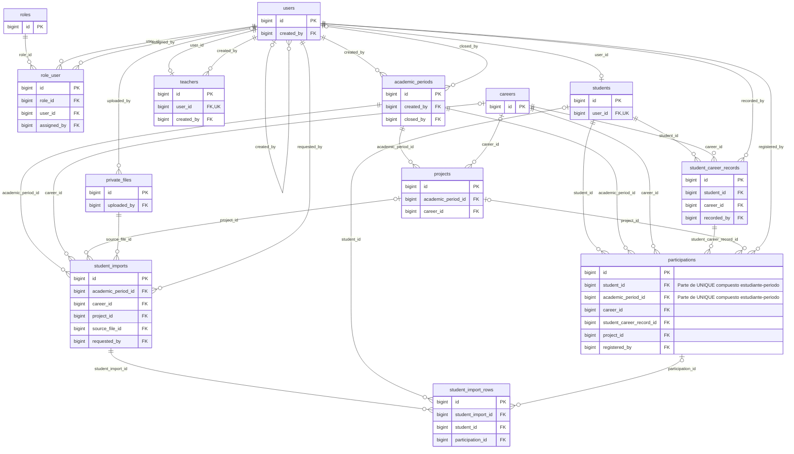
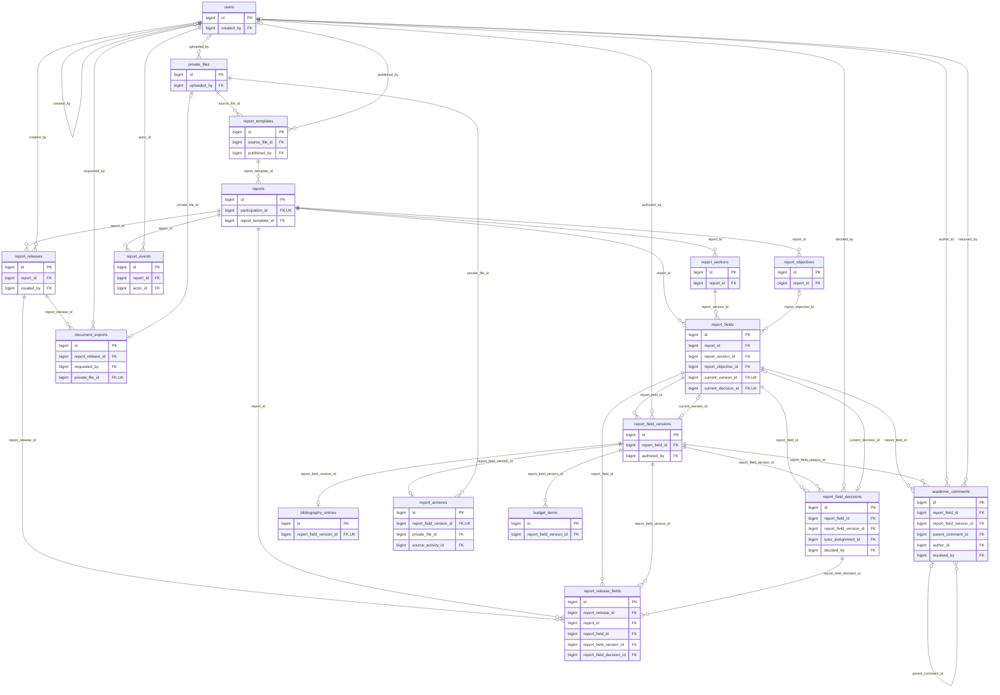

# SIGEV-ITSUP — Diseño físico propuesto

Fecha: 9 de noviembre de 2026. Motor objetivo: MariaDB 11.8.6 / InnoDB.
Estado: propuesta técnica para revisión; no es autorización para implementar ni ejecutar DDL.

## Lectura

ERD global con todas las tablas y sus claves primarias/foráneas. `||` uno obligatorio, `|o` cero o uno en el padre, `o{` cero a muchos hijos y `o|` cero a uno. La cardinalidad final puede restringirse adicionalmente por las FK compuestas, UNIQUE y reglas transaccionales del documento 4. Un puntero vigente opcional introduce un ciclo intencional, no una nueva fuente de contenido. Los atributos no clave están en el diccionario.

`audit_events.entity_type/entity_id`, sessions.user_id y password_reset_tokens.email son referencias lógicas sin FK declarativa; se explican en el diccionario. Las tablas cache, cache_locks, jobs, job_batches, failed_jobs y migrations son infraestructura sin relaciones de negocio. No representan módulos redundantes.

## Unicidad y cardinalidades confirmadas — Prompt 003

- `participations`: **UNIQUE (student_id, academic_period_id)**. Los dos atributos forman una sola clave alternativa; ninguno es único por separado. La anotación aparece en sus tres entidades Mermaid (global, expediente y coordinación).
- `projects |o--o{ participations`: cada participación tiene 0..1 proyecto solo mientras se prepara; al ejecutar jornadas debe tener exactamente uno válido del mismo período. Un proyecto puede recibir varios estudiantes. Se conserva la FK compuesta proyecto/período.
- Estudiante y período tienen relaciones 1:N históricas con participations; la pareja estudiante/período se limita a una sola fila incluso con proyectos distintos.
- `participations ||--o| reports`: máximo un informe mediante **UNIQUE (participation_id)**; corregirlo no crea otro.
- `attendance_days`: **UNIQUE (participation_id, local_date)**, con varios intervalos por jornada y decisión completa del tutor. Reasignar tutor no cambia participation_id ni autorías.
- Reimportación coincidente reutiliza cuenta y participación; carrera/proyecto diferentes son conflicto administrativo. El proyecto no se cambia libremente con jornadas o aprobaciones históricas.

## Modelo global

```mermaid
erDiagram
    users {
        bigint id PK
        bigint created_by FK
    }
    roles {
        bigint id PK
    }
    role_user {
        bigint id PK
        bigint role_id FK
        bigint user_id FK
        bigint assigned_by FK
    }
    students {
        bigint id PK
        bigint user_id FK,UK
    }
    teachers {
        bigint id PK
        bigint user_id FK,UK
        bigint created_by FK
    }
    careers {
        bigint id PK
    }
    academic_periods {
        bigint id PK
        bigint created_by FK
        bigint closed_by FK
    }
    student_career_records {
        bigint id PK
        bigint student_id FK
        bigint career_id FK
        bigint recorded_by FK
    }
    projects {
        bigint id PK
        bigint academic_period_id FK
        bigint career_id FK
    }
    %% participations: UNIQUE (student_id, academic_period_id), clave compuesta; no unicidad individual.
    participations {
        bigint id PK
        bigint student_id FK "Parte de UNIQUE compuesto estudiante-periodo"
        bigint academic_period_id FK "Parte de UNIQUE compuesto estudiante-periodo"
        bigint career_id FK
        bigint student_career_record_id FK
        bigint project_id FK
        bigint registered_by FK
    }
    private_files {
        bigint id PK
        bigint uploaded_by FK
    }
    student_imports {
        bigint id PK
        bigint academic_period_id FK
        bigint career_id FK
        bigint project_id FK
        bigint source_file_id FK
        bigint requested_by FK
    }
    student_import_rows {
        bigint id PK
        bigint student_import_id FK
        bigint student_id FK
        bigint participation_id FK
    }
    host_institutions {
        bigint id PK
    }
    institution_areas {
        bigint id PK
        bigint host_institution_id FK
    }
    placement_groups {
        bigint id PK
        bigint academic_period_id FK
        bigint created_by FK
    }
    group_memberships {
        bigint id PK
        bigint placement_group_id FK
        bigint participation_id FK
        bigint academic_period_id FK
        bigint assigned_by FK
    }
    tutor_assignments {
        bigint id PK
        bigint participation_id FK
        bigint teacher_id FK
        bigint assigned_by FK
    }
    placement_configurations {
        bigint id PK
        bigint academic_period_id FK
        bigint placement_group_id FK
        bigint host_institution_id FK
        bigint institution_area_id FK
        bigint created_by FK
    }
    participation_configurations {
        bigint id PK
        bigint participation_id FK
        bigint placement_configuration_id FK
        bigint academic_period_id FK
        bigint assigned_by FK
    }
    schedule_intervals {
        bigint id PK
        bigint placement_configuration_id FK
    }
    attendance_days {
        bigint id PK
        bigint participation_id FK
        bigint current_review_id FK,UK
    }
    attendance_intervals {
        bigint id PK
        bigint attendance_day_id FK
        bigint participation_id FK
        bigint participation_configuration_id FK
        bigint placement_configuration_id FK
        bigint schedule_interval_id FK
    }
    activities {
        bigint id PK
        bigint attendance_interval_id FK
        bigint created_by FK
    }
    activity_evidences {
        bigint id PK
        bigint activity_id FK,UK
        bigint private_file_id FK,UK
    }
    attendance_incidents {
        bigint id PK
        bigint attendance_day_id FK
        bigint attendance_interval_id FK
        bigint support_file_id FK
        bigint recorded_by FK
    }
    attendance_reviews {
        bigint id PK
        bigint attendance_day_id FK
        bigint participation_id FK
        bigint tutor_assignment_id FK
        bigint reviewed_by FK
        bigint support_file_id FK
    }
    attendance_events {
        bigint id PK
        bigint attendance_day_id FK
        bigint actor_id FK
    }
    report_templates {
        bigint id PK
        bigint source_file_id FK
        bigint published_by FK
    }
    reports {
        bigint id PK
        bigint participation_id FK,UK
        bigint report_template_id FK
    }
    report_sections {
        bigint id PK
        bigint report_id FK
    }
    report_objectives {
        bigint id PK
        bigint report_id FK
    }
    report_fields {
        bigint id PK
        bigint report_id FK
        bigint report_section_id FK
        bigint report_objective_id FK
        bigint current_version_id FK,UK
        bigint current_decision_id FK,UK
    }
    report_field_versions {
        bigint id PK
        bigint report_field_id FK
        bigint authored_by FK
    }
    academic_comments {
        bigint id PK
        bigint report_field_id FK
        bigint report_field_version_id FK
        bigint parent_comment_id FK
        bigint author_id FK
        bigint resolved_by FK
    }
    report_field_decisions {
        bigint id PK
        bigint report_field_id FK
        bigint report_field_version_id FK
        bigint tutor_assignment_id FK
        bigint decided_by FK
    }
    report_events {
        bigint id PK
        bigint report_id FK
        bigint actor_id FK
    }
    bibliography_entries {
        bigint id PK
        bigint report_field_version_id FK,UK
    }
    report_annexes {
        bigint id PK
        bigint report_field_version_id FK,UK
        bigint private_file_id FK
        bigint source_activity_id FK
    }
    budget_items {
        bigint id PK
        bigint report_field_version_id FK
    }
    report_releases {
        bigint id PK
        bigint report_id FK
        bigint created_by FK
    }
    report_release_fields {
        bigint id PK
        bigint report_release_id FK
        bigint report_id FK
        bigint report_field_id FK
        bigint report_field_version_id FK
        bigint report_field_decision_id FK
    }
    document_exports {
        bigint id PK
        bigint report_release_id FK
        bigint requested_by FK
        bigint private_file_id FK,UK
    }
    audit_events {
        bigint id PK
        bigint actor_id FK
        bigint academic_period_id FK
    }
    password_reset_tokens {
        varchar email PK
    }
    sessions {
        varchar id PK
    }
    cache {
        varchar key PK
    }
    cache_locks {
        varchar key PK
    }
    jobs {
        bigint id PK
    }
    job_batches {
        varchar id PK
    }
    failed_jobs {
        bigint id PK
    }
    migrations {
        int id PK
    }
    users |o--o{ users : "created_by"
    roles ||--o{ role_user : "role_id"
    users ||--o{ role_user : "user_id"
    users ||--o{ role_user : "assigned_by"
    users ||--o| students : "user_id"
    users ||--o| teachers : "user_id"
    users ||--o{ teachers : "created_by"
    users ||--o{ academic_periods : "created_by"
    users |o--o{ academic_periods : "closed_by"
    students ||--o{ student_career_records : "student_id"
    careers ||--o{ student_career_records : "career_id"
    users ||--o{ student_career_records : "recorded_by"
    academic_periods ||--o{ projects : "academic_period_id"
    careers |o--o{ projects : "career_id"
    students ||--o{ participations : "student_id"
    academic_periods ||--o{ participations : "academic_period_id"
    careers ||--o{ participations : "career_id"
    student_career_records ||--o{ participations : "student_career_record_id"
    projects |o--o{ participations : "project_id"
    users ||--o{ participations : "registered_by"
    users |o--o{ private_files : "uploaded_by"
    academic_periods ||--o{ student_imports : "academic_period_id"
    careers |o--o{ student_imports : "career_id"
    projects |o--o{ student_imports : "project_id"
    private_files ||--o{ student_imports : "source_file_id"
    users ||--o{ student_imports : "requested_by"
    student_imports ||--o{ student_import_rows : "student_import_id"
    students |o--o{ student_import_rows : "student_id"
    participations |o--o{ student_import_rows : "participation_id"
    host_institutions ||--o{ institution_areas : "host_institution_id"
    academic_periods ||--o{ placement_groups : "academic_period_id"
    users ||--o{ placement_groups : "created_by"
    placement_groups ||--o{ group_memberships : "placement_group_id"
    participations ||--o{ group_memberships : "participation_id"
    academic_periods ||--o{ group_memberships : "academic_period_id"
    users ||--o{ group_memberships : "assigned_by"
    participations ||--o{ tutor_assignments : "participation_id"
    teachers ||--o{ tutor_assignments : "teacher_id"
    users ||--o{ tutor_assignments : "assigned_by"
    academic_periods ||--o{ placement_configurations : "academic_period_id"
    placement_groups |o--o{ placement_configurations : "placement_group_id"
    host_institutions ||--o{ placement_configurations : "host_institution_id"
    institution_areas ||--o{ placement_configurations : "institution_area_id"
    users ||--o{ placement_configurations : "created_by"
    participations ||--o{ participation_configurations : "participation_id"
    placement_configurations ||--o{ participation_configurations : "placement_configuration_id"
    academic_periods ||--o{ participation_configurations : "academic_period_id"
    users ||--o{ participation_configurations : "assigned_by"
    placement_configurations ||--o{ schedule_intervals : "placement_configuration_id"
    participations ||--o{ attendance_days : "participation_id"
    attendance_reviews |o--o| attendance_days : "current_review_id"
    attendance_days ||--o{ attendance_intervals : "attendance_day_id"
    participations ||--o{ attendance_intervals : "participation_id"
    participation_configurations ||--o{ attendance_intervals : "participation_configuration_id"
    placement_configurations ||--o{ attendance_intervals : "placement_configuration_id"
    schedule_intervals ||--o{ attendance_intervals : "schedule_interval_id"
    attendance_intervals ||--o{ activities : "attendance_interval_id"
    users ||--o{ activities : "created_by"
    activities ||--o| activity_evidences : "activity_id"
    private_files ||--o| activity_evidences : "private_file_id"
    attendance_days ||--o{ attendance_incidents : "attendance_day_id"
    attendance_intervals |o--o{ attendance_incidents : "attendance_interval_id"
    private_files |o--o{ attendance_incidents : "support_file_id"
    users |o--o{ attendance_incidents : "recorded_by"
    attendance_days ||--o{ attendance_reviews : "attendance_day_id"
    participations ||--o{ attendance_reviews : "participation_id"
    tutor_assignments ||--o{ attendance_reviews : "tutor_assignment_id"
    users ||--o{ attendance_reviews : "reviewed_by"
    private_files |o--o{ attendance_reviews : "support_file_id"
    attendance_days ||--o{ attendance_events : "attendance_day_id"
    users |o--o{ attendance_events : "actor_id"
    private_files ||--o{ report_templates : "source_file_id"
    users |o--o{ report_templates : "published_by"
    participations ||--o| reports : "participation_id"
    report_templates ||--o{ reports : "report_template_id"
    reports ||--o{ report_sections : "report_id"
    reports ||--o{ report_objectives : "report_id"
    reports ||--o{ report_fields : "report_id"
    report_sections ||--o{ report_fields : "report_section_id"
    report_objectives |o--o{ report_fields : "report_objective_id"
    report_field_versions |o--o| report_fields : "current_version_id"
    report_field_decisions |o--o| report_fields : "current_decision_id"
    report_fields ||--o{ report_field_versions : "report_field_id"
    users ||--o{ report_field_versions : "authored_by"
    report_fields ||--o{ academic_comments : "report_field_id"
    report_field_versions ||--o{ academic_comments : "report_field_version_id"
    academic_comments |o--o{ academic_comments : "parent_comment_id"
    users ||--o{ academic_comments : "author_id"
    users |o--o{ academic_comments : "resolved_by"
    report_fields ||--o{ report_field_decisions : "report_field_id"
    report_field_versions ||--o{ report_field_decisions : "report_field_version_id"
    tutor_assignments ||--o{ report_field_decisions : "tutor_assignment_id"
    users ||--o{ report_field_decisions : "decided_by"
    reports ||--o{ report_events : "report_id"
    users ||--o{ report_events : "actor_id"
    report_field_versions ||--o| bibliography_entries : "report_field_version_id"
    report_field_versions ||--o| report_annexes : "report_field_version_id"
    private_files ||--o{ report_annexes : "private_file_id"
    activities |o--o{ report_annexes : "source_activity_id"
    report_field_versions ||--o{ budget_items : "report_field_version_id"
    reports ||--o{ report_releases : "report_id"
    users ||--o{ report_releases : "created_by"
    report_releases ||--o{ report_release_fields : "report_release_id"
    reports ||--o{ report_release_fields : "report_id"
    report_fields ||--o{ report_release_fields : "report_field_id"
    report_field_versions ||--o{ report_release_fields : "report_field_version_id"
    report_field_decisions ||--o{ report_release_fields : "report_field_decision_id"
    report_releases ||--o{ document_exports : "report_release_id"
    users ||--o{ document_exports : "requested_by"
    private_files |o--o| document_exports : "private_file_id"
    users |o--o{ audit_events : "actor_id"
    academic_periods |o--o{ audit_events : "academic_period_id"
```

## Identidad y expediente

Submodelo; las referencias a otros dominios se conservan en el modelo global.

## Coordinación, jornadas y supervisión

Submodelo; las referencias a otros dominios se conservan en el modelo global.

```mermaid
erDiagram
    users {
        bigint id PK
        bigint created_by FK
    }
    students {
        bigint id PK
        bigint user_id FK,UK
    }
    teachers {
        bigint id PK
        bigint user_id FK,UK
        bigint created_by FK
    }
    careers {
        bigint id PK
    }
    academic_periods {
        bigint id PK
        bigint created_by FK
        bigint closed_by FK
    }
    student_career_records {
        bigint id PK
        bigint student_id FK
        bigint career_id FK
        bigint recorded_by FK
    }
    projects {
        bigint id PK
        bigint academic_period_id FK
        bigint career_id FK
    }
    %% participations: UNIQUE (student_id, academic_period_id), clave compuesta; no unicidad individual.
    participations {
        bigint id PK
        bigint student_id FK "Parte de UNIQUE compuesto estudiante-periodo"
        bigint academic_period_id FK "Parte de UNIQUE compuesto estudiante-periodo"
        bigint career_id FK
        bigint student_career_record_id FK
        bigint project_id FK
        bigint registered_by FK
    }
    private_files {
        bigint id PK
        bigint uploaded_by FK
    }
    host_institutions {
        bigint id PK
    }
    institution_areas {
        bigint id PK
        bigint host_institution_id FK
    }
    placement_groups {
        bigint id PK
        bigint academic_period_id FK
        bigint created_by FK
    }
    group_memberships {
        bigint id PK
        bigint placement_group_id FK
        bigint participation_id FK
        bigint academic_period_id FK
        bigint assigned_by FK
    }
    tutor_assignments {
        bigint id PK
        bigint participation_id FK
        bigint teacher_id FK
        bigint assigned_by FK
    }
    placement_configurations {
        bigint id PK
        bigint academic_period_id FK
        bigint placement_group_id FK
        bigint host_institution_id FK
        bigint institution_area_id FK
        bigint created_by FK
    }
    participation_configurations {
        bigint id PK
        bigint participation_id FK
        bigint placement_configuration_id FK
        bigint academic_period_id FK
        bigint assigned_by FK
    }
    schedule_intervals {
        bigint id PK
        bigint placement_configuration_id FK
    }
    attendance_days {
        bigint id PK
        bigint participation_id FK
        bigint current_review_id FK,UK
    }
    attendance_intervals {
        bigint id PK
        bigint attendance_day_id FK
        bigint participation_id FK
        bigint participation_configuration_id FK
        bigint placement_configuration_id FK
        bigint schedule_interval_id FK
    }
    activities {
        bigint id PK
        bigint attendance_interval_id FK
        bigint created_by FK
    }
    activity_evidences {
        bigint id PK
        bigint activity_id FK,UK
        bigint private_file_id FK,UK
    }
    attendance_incidents {
        bigint id PK
        bigint attendance_day_id FK
        bigint attendance_interval_id FK
        bigint support_file_id FK
        bigint recorded_by FK
    }
    attendance_reviews {
        bigint id PK
        bigint attendance_day_id FK
        bigint participation_id FK
        bigint tutor_assignment_id FK
        bigint reviewed_by FK
        bigint support_file_id FK
    }
    attendance_events {
        bigint id PK
        bigint attendance_day_id FK
        bigint actor_id FK
    }
    users |o--o{ users : "created_by"
    users ||--o| students : "user_id"
    users ||--o| teachers : "user_id"
    users ||--o{ teachers : "created_by"
    users ||--o{ academic_periods : "created_by"
    users |o--o{ academic_periods : "closed_by"
    students ||--o{ student_career_records : "student_id"
    careers ||--o{ student_career_records : "career_id"
    users ||--o{ student_career_records : "recorded_by"
    academic_periods ||--o{ projects : "academic_period_id"
    careers |o--o{ projects : "career_id"
    students ||--o{ participations : "student_id"
    academic_periods ||--o{ participations : "academic_period_id"
    careers ||--o{ participations : "career_id"
    student_career_records ||--o{ participations : "student_career_record_id"
    projects |o--o{ participations : "project_id"
    users ||--o{ participations : "registered_by"
    users |o--o{ private_files : "uploaded_by"
    host_institutions ||--o{ institution_areas : "host_institution_id"
    academic_periods ||--o{ placement_groups : "academic_period_id"
    users ||--o{ placement_groups : "created_by"
    placement_groups ||--o{ group_memberships : "placement_group_id"
    participations ||--o{ group_memberships : "participation_id"
    academic_periods ||--o{ group_memberships : "academic_period_id"
    users ||--o{ group_memberships : "assigned_by"
    participations ||--o{ tutor_assignments : "participation_id"
    teachers ||--o{ tutor_assignments : "teacher_id"
    users ||--o{ tutor_assignments : "assigned_by"
    academic_periods ||--o{ placement_configurations : "academic_period_id"
    placement_groups |o--o{ placement_configurations : "placement_group_id"
    host_institutions ||--o{ placement_configurations : "host_institution_id"
    institution_areas ||--o{ placement_configurations : "institution_area_id"
    users ||--o{ placement_configurations : "created_by"
    participations ||--o{ participation_configurations : "participation_id"
    placement_configurations ||--o{ participation_configurations : "placement_configuration_id"
    academic_periods ||--o{ participation_configurations : "academic_period_id"
    users ||--o{ participation_configurations : "assigned_by"
    placement_configurations ||--o{ schedule_intervals : "placement_configuration_id"
    participations ||--o{ attendance_days : "participation_id"
    attendance_reviews |o--o| attendance_days : "current_review_id"
    attendance_days ||--o{ attendance_intervals : "attendance_day_id"
    participations ||--o{ attendance_intervals : "participation_id"
    participation_configurations ||--o{ attendance_intervals : "participation_configuration_id"
    placement_configurations ||--o{ attendance_intervals : "placement_configuration_id"
    schedule_intervals ||--o{ attendance_intervals : "schedule_interval_id"
    attendance_intervals ||--o{ activities : "attendance_interval_id"
    users ||--o{ activities : "created_by"
    activities ||--o| activity_evidences : "activity_id"
    private_files ||--o| activity_evidences : "private_file_id"
    attendance_days ||--o{ attendance_incidents : "attendance_day_id"
    attendance_intervals |o--o{ attendance_incidents : "attendance_interval_id"
    private_files |o--o{ attendance_incidents : "support_file_id"
    users |o--o{ attendance_incidents : "recorded_by"
    attendance_days ||--o{ attendance_reviews : "attendance_day_id"
    participations ||--o{ attendance_reviews : "participation_id"
    tutor_assignments ||--o{ attendance_reviews : "tutor_assignment_id"
    users ||--o{ attendance_reviews : "reviewed_by"
    private_files |o--o{ attendance_reviews : "support_file_id"
    attendance_days ||--o{ attendance_events : "attendance_day_id"
    users |o--o{ attendance_events : "actor_id"
```

## Informe y documentos

Submodelo; las referencias a otros dominios se conservan en el modelo global.

